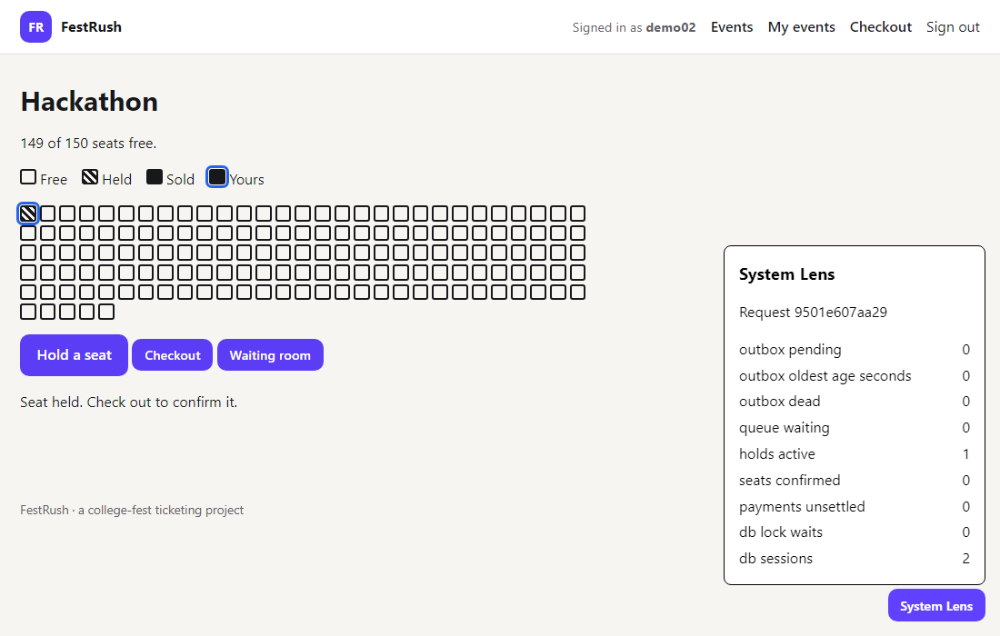

<p align="center"></p>

> **New here? Read [START_HERE.md](START_HERE.md):** how to run it, where to read, and the running log of updates.

**College-fest ticketing that is built never to sell a seat twice, with the tests and benchmarks to
show it.**



FestRush began as a small project covering a few cloud-computing topics: one FastAPI app for a
college fest. This is a whole new version of it: seat holds that expire, idempotent payments, a
queue and worker, a gateway, metrics and traces, a live seat map, and load and chaos tests that
check the system never sells a seat twice.

**What was measured** (copied from [bench/results/SUMMARY.md](bench/results/SUMMARY.md)): with 300
students and 30 seats the deliberately unsafe strategy sold 40; the three safe ones sold exactly 30.
At 5,000 students and 200 seats the safe ones again oversold nothing. Sending every write twice with
the same key still produced one order and one charge per seat. The summary also lists results that
went against the plan.

**Status: version 2.0.0.** Not done, and said plainly: the inventory is not a separate service, the
front end is plain JavaScript rather than React, and there is no recorded replay demo. See the
[changelog](CHANGELOG.md), the [modernization summary](docs/MODERNIZATION_SUMMARY.md), the
[roadmap](docs/roadmap.md), [how seats are sold exactly once](docs/concurrency.md), [where the
system was split and where it was not](docs/architecture.md) and the [API reference](docs/api.md).
The starting point was audited in [docs/audit.md](docs/audit.md).

## Quick start

```bash
docker compose up
```

That starts PostgreSQL 18, applies the migrations, runs the background worker, loads nine demo
events and five demo accounts
(`demo01` to `demo05`; the password is `FESTRUSH_DEMO_PASSWORD`, `festrush-demo` by default) and
serves the app at <http://localhost:8080> and, through the nginx gateway, at <http://localhost:8088>. Ports and passwords are in [.env.example](.env.example).

## Development

You need [uv](https://docs.astral.sh/uv/) and Docker.

```bash
docker compose up -d db          # PostgreSQL on localhost:5440
uv sync
export FESTRUSH_SECRET_KEY=local-development-only-secret-change-me
uv run festrush migrate
uv run festrush seed
uv run festrush serve            # http://127.0.0.1:8080
```

```bash
uv run pytest                    # tests against a real PostgreSQL (creates festrush_test)
uv run ruff check src tests && uv run ruff format --check src tests
uv run mypy
```

The v1 characterization suite pins what the original code did, bugs included, and needs the
old dependency versions it was written for:

```bash
uv run --no-project --with-requirements tests/characterization/requirements-legacy.txt \
  pytest tests/characterization --confcutdir=tests/characterization -m legacy -o addopts=""
```

## Dashboards and traces

```bash
FESTRUSH_OTLP_ENDPOINT=http://jaeger:4318 docker compose --profile observability up -d
```

Grafana at <http://localhost:3300> (dashboard provisioned, anonymous viewing), Prometheus at
:9090, Jaeger at :16686. Nothing leaves your machine.

## Concurrency tests and benchmarks

The seat rush runs as a real test: students, seats, the app, the worker and Locust, then the
invariants are checked against the database.

```bash
docker compose up -d db
uv run python bench/run.py --strategy atomic_update --users 300 --seats 30
# the same at the size in the docs, inside Docker so the environment is the same for everyone:
docker compose --profile bench run --rm bench --strategy atomic_update --users 5000 --seats 200
uv run python bench/summarize.py
```

The full comparison is `bench/run_matrix.sh`. Seats are claimed through `POST
/api/events/{id}/reserve`; the strategy is `FESTRUSH_INVENTORY_STRATEGY` (`naive`, `row_lock`,
`atomic_update`, `skip_locked`).

## Load tests for the web pages

The four Locust files in [locust/](locust/) are kept from the original version. Each simulated student now
signs up and signs in first.

```bash
uv run locust -f locust/locust/journey_locustfile.py --host http://localhost:8080
```

## Layout

| Path | Contents |
| :-- | :-- |
| `main.py` | Entry point kept from v1: `uvicorn main:app` |
| `src/festrush/` | The application: routes, services, security, templates |
| `db/migrations/` | The schema, as numbered SQL files applied once each |
| `tests/` | Tests against PostgreSQL; `tests/characterization/` pins v1 |
| `locust/` | Load tests for each page journey (kept from the original version) |
| `bench/` | The seat-rush benchmark: scenarios, runner, results and summary script |
| `legacy/v1/` | The original version, unchanged apart from one removed hardcoded identifier |
| `docs/` | Audit, research, roadmap, architecture, API reference, launch drafts |
| `e2e/` | Playwright journey and accessibility checks; `screenshots.mjs` rebuilds the images |

## Contributing

See [CONTRIBUTING.md](CONTRIBUTING.md), [good first issues](docs/good-first-issues.md),
[SECURITY.md](SECURITY.md) and the [Code of Conduct](CODE_OF_CONDUCT.md).

## License

[MIT](LICENSE).
